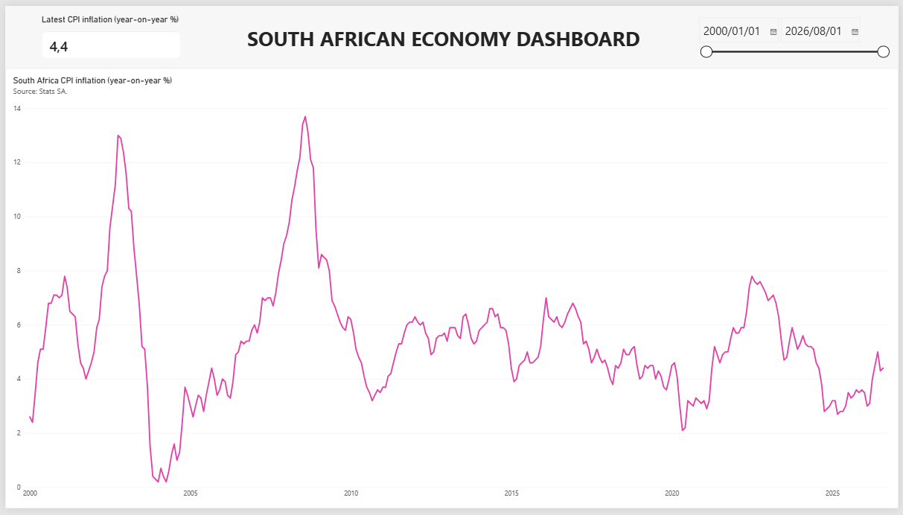

# South African Economy Dashboard

A Power BI dashboard that tracks key South African economic indicators, supported by a Python data pipeline.

## About this project

This project pulls official South African economic data, cleans it with Python, and presents it in an interactive dashboard. It is built in stages, and this repo will grow as each stage is completed.
## Preview

## What I found

- **Inflation and the repo rate are significantly related, but the link is not stable over time.** Over 297 months (December 2001 to August 2026), a one-point rise in inflation goes with a rise of about 0.56 points in the repo rate (correlation 0.57). This is statistically significant (p < 0.001) using Newey-West standard errors, which allow for both series being highly persistent. The link is stronger for 12-month changes (correlation 0.74). However, it is driven mostly by 2002 and 2008: the correlation was 0.78 from 2001 to 2009, about -0.11 from 2010 to 2019 and 0.13 from 2020 to 2026. Tests of whether one leads the other were significant in both directions, so I can't say which drives which. The repo rate peaked near each inflation spike (13.5% in September 2002, 12.0% in June 2008 and 8.25% in May 2023), but the timing differs each time.
- **Interest rates are relatively high compared with inflation.** In August 2026 the repo rate was 7.0% and inflation was 4.4%, a gap of about 2.6 percentage points. This is a simple measure (the repo rate minus the latest inflation rate), not adjusted for expected inflation. The average gap since 2002 is about 1.8 points.
- **Unemployment has stayed above 30% since 2020.** It was 23.2% in Q1 2008, hit 35.3% in Q4 2021, and was 33.6% in Q2 2026. It has not fallen below 30% in any quarter since Q3 2020. The dip to 23.3% in Q2 2020 reflects people who stopped looking for work during lockdown, not a real improvement.
- **Growth has been weaker since Covid.** Year-on-year GDP growth averaged about 2.6% from Q4 2000 to Q4 2019, and about 1.2% from Q1 2022 to Q2 2026. The latest figure, for Q2 2026, is 0.85%.

These are descriptions of the data, not proof of cause and effect.

## Stage 1 indicators

- Real GDP growth (year-on-year %)
- CPI inflation (year-on-year %)
- Unemployment rate
- Repo rate

## Data sources

- CPI inflation: Stats SA (monthly, from January 2000)
- Repo rate: South African Reserve Bank policy rate (monthly, from December 2001, when the SARB series begins)
- GDP growth: calculated from the SARB's seasonally adjusted real GDP at constant 2015 prices (quarterly, from Q4 2000)
- Unemployment: Stats SA Quarterly Labour Force Survey, via the BER Data Portal (quarterly, from Q1 2008, when the survey began)

Quarterly figures are repeated across the three months of their quarter so they line up with the monthly data.

## Tools

- Python (data collection and cleaning)
- Power BI (dashboard)

## How to run

1. Install the packages: `pip install -r requirements.txt`
2. Clean each indicator:
   - `python src/clean_cpi.py data/raw/CPIHistory.pdf data/clean/cpi_inflation.csv`
   - `python src/clean_repo_rate.py data/raw/HistoricalRateDetail.pdf data/clean/repo_rate.csv`
   - `python src/clean_gdp.py data/raw/SDDSDetail.csv data/clean/gdp_growth.csv`
   - `python src/clean_unemployment.py data/raw/ber-labour-official-lu3.csv data/clean/unemployment_rate.csv`
3. Combine them: `python src/build_dataset.py`
4. Run the inflation and repo rate analysis: `python src/analyse_inflation_repo.py`

The Power BI dashboard reads `data/clean/economy_monthly.csv`.

## Status

Stage 1 complete: CPI inflation, repo rate, GDP growth and unemployment.

## Author

Lesedi Motsomane

